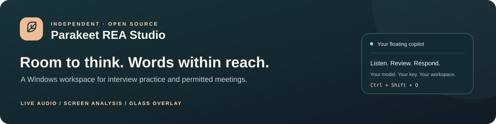
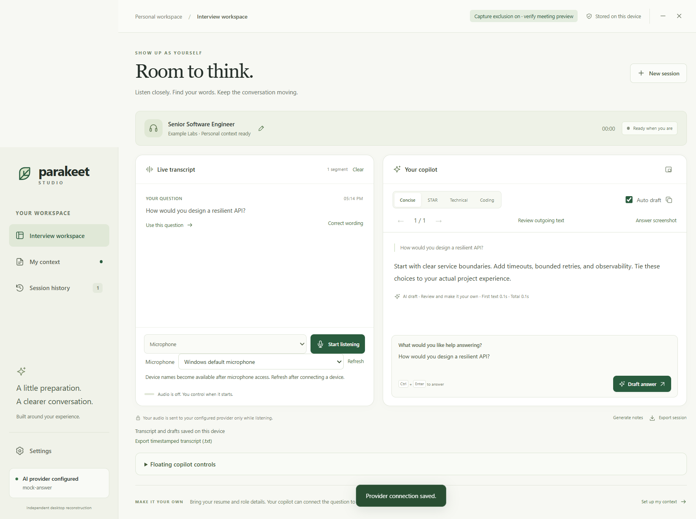
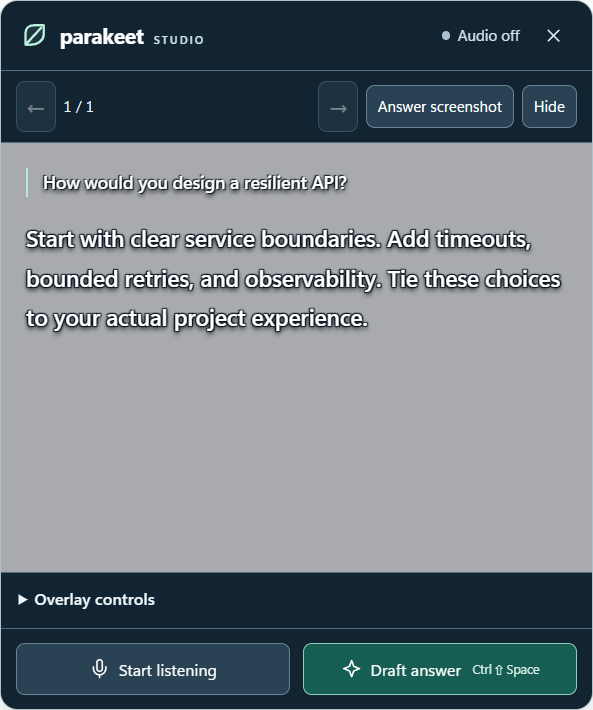

# Parakeet REA Studio

[Production readiness review and prioritized patch queue](docs/PRODUCTION_READINESS.md) — current gaps, completed response-integrity fixes, and acceptance gates.

[](https://github.com/AYASKA-in/parakeet-rea-studio/actions/workflows/windows.yml) [](LICENSE)  

An independent Windows assistant for **interview practice and permitted meetings**. Listen to microphone/call audio, draft AI answers, analyze a screenshot, and keep readable words in a movable glass overlay.

**[Download published v0.5.8 EXE](https://github.com/AYASKA-in/parakeet-rea-studio/releases/download/v0.5.8/Parakeet-Studio-0.5.8-portable.exe)** · [Release & checksums](https://github.com/AYASKA-in/parakeet-rea-studio/releases/tag/v0.5.8) · [Full user guide](docs/USER_GUIDE.md) · [Get an API key](docs/API_KEYS.md)

> [!IMPORTANT]
> **Experimental prerelease.** AI answers can be wrong. Cloud features require internet and provider access. Capture exclusion depends on Windows and the sharing tool; universal invisibility and a 100% success rate are not guaranteed. Use assistance only where allowed.

The desktop app is named **Parakeet Studio**. This independently written, MIT-licensed project is not affiliated with ParakeetAI and includes no vendor binaries or extracted source.

**New in 0.5.8:** a slate-and-teal workspace, larger transcript/answer text, listening controls at the top, clearer keyboard hints and more readable glass controls. [Design and accessibility notes](docs/UI_DESIGN.md).

**On this page:** [Release status](#release-status) · [Install](#download-and-run) · [First answer](#your-first-answer) · [Features](#what-you-can-do) · [Overlay & shortcuts](#glass-overlay-and-shortcuts) · [Privacy](#privacy-and-your-data) · [Reliability](#speed-and-reliability) · [Help](#quick-troubleshooting) · [Build](#build-from-source) · [Signing](#code-signing-policy) · [Validation](#validation-and-remaining-checks)


## Release status

| Channel | What you get |
|---|---|
| **Published download: v0.5.8** | The existing **unsigned portable EXE** linked above. It predates the latest hardening and recovery changes. |
| **Current main source: v0.7.0 candidate** | Direct screenshot answers, recovery feedback, stronger persistence/privacy controls, expanded evaluations and an NSIS installer build. **Experimental and unsigned.** [Build the current source](#build-from-source). |
| **Public v0.7.0 binaries** | Not released yet. A source update does not replace the published v0.5.8 EXE; no v0.7.0 release download is claimed here. |

The feature descriptions below refer to the current source unless a version is stated. Check your installed version before expecting a newer workflow. See [latest source changes](#latest-source-changes), [recorded validation](#validation-and-remaining-checks) and the [release procedure](docs/RELEASING.md).

## Download and run

| You need | Details |
|---|---|
| Windows | Windows 11 x64 is tested; ARM64 and other operating systems are not validated |
| API access | Your own Gemini key, or an explicitly configured compatible server |
| Internet | Required for cloud AI; no offline model is bundled |
| Audio access | Working devices/drivers and Windows microphone permissions |
| Runtime | Portable app includes Electron and its helper; no Node.js, Python or separate .NET SDK needed |

1. Download **[Parakeet-Studio-0.5.8-portable.exe](https://github.com/AYASKA-in/parakeet-rea-studio/releases/download/v0.5.8/Parakeet-Studio-0.5.8-portable.exe)**. This is the application. The source ZIP is for developers.
2. Keep it in a folder you control, such as `Documents\Parakeet Studio`. Run the EXE directly; there is no installer. First launch extracts the runtime and can take longer.
3. Compare its hash with `SHA256SUMS.txt` from the [same release](https://github.com/AYASKA-in/parakeet-rea-studio/releases/tag/v0.5.8):

   ```powershell
   Get-FileHash -Algorithm SHA256 '.\Parakeet-Studio-0.5.8-portable.exe'
   ```

4. This community build is **unsigned** and may show an unknown-publisher warning. Verify the source/checksum before deciding to run it. Do not disable Windows security.
5. Open Settings, configure your provider and choose a data-use policy. **No shared API key is included.**

If the app seems missing, press **Ctrl+Shift+M** or reopen the same EXE. Capture protection hides its taskbar buttons. The browser preview is an interface demo; use the desktop EXE for AI/audio.

## Your first answer

1. Create your own key at [Google AI Studio](https://aistudio.google.com/apikey). Follow the [complete key guide](docs/API_KEYS.md), including project access and billing checks.
2. In Settings → **Google Gemini**, enter:

   | Setting | Starting value |
   |---|---|
   | API base URL | `https://generativelanguage.googleapis.com/v1beta` |
   | API key | Your complete key, entered directly in the app |
   | Answer model | `gemini-3.5-flash-lite` |
   | Transcription model | `gemini-3.5-transcribe-live` |

3. For an unpaid account, choose **Unpaid cloud — non-personal practice only** and start with synthetic questions. For zero billing charges, use an eligible free-tier project without billing; the app cannot verify that account state.
4. Click **Save connection**. Type “Explain a hash map” and click **Draft answer**. A saved-settings message is not an authentication test; the request checks actual key/model/quota access.
5. Choose **Microphone**, then **Start listening** and ask a short practice question. Test **System audio** separately before using both. Use headphones to reduce feedback.
6. Open the floating copilot with **Ctrl+Shift+O**. Stop listening when finished and check saved status.

One Gemini key supports answers, transcription and supported screenshot/PDF requests. Model availability and free quotas can change. Check Google's [pricing](https://ai.google.dev/gemini-api/docs/pricing), [limits](https://ai.google.dev/gemini-api/docs/rate-limits) and [terms](https://ai.google.dev/gemini-api/terms). A billing-enabled project may incur charges. There is no automatic paid fallback or key cycling.

<details>
<summary><strong>Using a local or OpenAI-compatible server?</strong></summary>

Select OpenAI-compatible API and supply its model IDs, token and base URL including `/v1`. Remote endpoints require HTTPS. Local server policy requires a loopback URL such as `http://127.0.0.1:1234/v1`. A no-auth server may accept a non-secret placeholder token such as `local-only`.

Full functionality requires streamed `/chat/completions`, multipart-WAV `/audio/transcriptions`, and image support for screenshots. A chat-only endpoint does not provide every feature. No local server/model is bundled; a local server may itself forward data to cloud services. See [provider setup](docs/API_KEYS.md#openai-compatible-and-local-servers).

</details>

## What you can do



| Capability | How it works |
|---|---|
| **Live transcription** | Microphone, system audio or both; separate source labels, interim/final text and editable finalized wording |
| **AI answer drafts** | Concise, STAR, Technical and Coding styles; Fast/Balanced/Careful priorities |
| **Auto draft** | Groups finalized question segments, waits for a pause and offers Send now/Dismiss |
| **Readable glass overlay** | Background-only opacity, fully opaque white text, dragging, nine anchors and click-through |
| **Screen analysis** | In v0.7.0 source, **Answer screenshot** sends the selected display directly; **Review / crop** provides an optional preview and crop. The published v0.5.8 workflow uses review. |
| **Resume context** | Local PDF/TXT/Markdown import and review; optional explicit AI PDF upload |
| **Local history** | Transcripts, drafts, notes, search/reopen, Markdown/text export and deletion |
| **Visible recovery** | Bounded reconnect buffer, saved gap notices, retained partial drafts and stopped capture after sleep |

Screenshots show synthetic local-provider fixtures. Their displayed timings are not cloud-latency benchmarks.

**All generated answers come from your configured AI provider.** Local code handles capture, question routing, context, display and saving. The app does not execute generated code. Review answers and test proposed solutions.

### Listening and automatic answers

Choose the correct microphone; Refresh updates the device list. System audio can include other applications' playback. You/Call labels identify the audio source, not individual speakers.

Auto draft is initially enabled. It uses finalized wording and a pause; **with both sources, only system/call audio triggers automatic drafts**. Check the pending question, correct critical names/numbers/negations and use **Send now** when needed. Indirect or multilingual requests may be missed. After an interruption, held questions require explicit review/send.

### Screen text, images and coding problems

Open **Answer screenshot** or press **Ctrl+Alt+Enter**. Select the display, inspect the preview/timestamp, crop around the problem and edit the question before sending. Fast/Balanced/Detail use longest-edge limits of 1600/2560/3840 pixels. Enlarge tiny text and crop tightly before increasing quality.

Captures expire after two minutes or a display-configuration change. Ordinary screen-content changes require **Refresh screenshot**. Pixels upload only after review/send; the image is transient and is not saved in session history. Image support depends on your model. No model can recover text absent from the captured pixels.

### Resume and personal context

Import a selectable-text PDF, TXT or Markdown file in **My context**. Local limits: **10 MB, 40 PDF pages, 50,000 applied characters**. Review reading order, dates and claims before applying. Scanned PDFs may need optional AI PDF import, which explicitly uploads the document after confirmation and is disabled in unpaid practice mode.

Personal context follows your selected data policy. Check every claimed qualification, employer and achievement. Clear context, clear transcript and delete session have different effects; see the [user guide](docs/USER_GUIDE.md#history-updates-and-removal).

## Glass overlay and shortcuts



Adjust **background opacity** from clear to 95%; white text stays opaque with shadow/glow. Increase the background over bright or busy content. Drag the header, choose an anchor, or move it with the shortcuts below. Click-through lets you interact with the content behind it.

| Shortcut | Action |
|---|---|
| **Ctrl+Enter** | Draft from the question field |
| **Ctrl+Shift+Space** | Send the pending question / draft an answer |
| **Ctrl+Shift+L** | Start/stop listening |
| **Ctrl+Shift+O** | Show/hide copilot |
| **Ctrl+Shift+M** | Show workspace |
| **Ctrl+Shift+H** | Hide copilot |
| **Ctrl+Shift+P** | Toggle click-through / restore mouse input |
| **Ctrl+Shift+← / → / ↑ / ↓** | Move copilot 32 pixels |
| **Ctrl+Shift+Home** | Center copilot |
| **Ctrl+Alt+← / →** | Previous/next answer |
| **Ctrl+Alt+↑ / ↓** | Scroll floating answer |
| **Ctrl+Alt+Enter** | Open screenshot review |

Settings reports unavailable global shortcuts and offers **Retry global shortcuts**. Close/reconfigure conflicting apps or reopen the EXE to reach the workspace. Shortcut remapping is not included.

## Privacy and your data

| Data or action | Important behavior |
|---|---|
| **API key** | Encrypted with Windows secure storage; bound to provider/server origin. Enter it in Settings, never in issues or source. Leave the field blank to preserve it; use Remove saved API key to clear it |
| **Audio** | Uploaded while listening. Listening is explicit; sleep/lock stops capture |
| **Screenshots** | Captured explicitly and sent only after review; other visible apps can appear, so inspect before upload |
| **Context** | Relevant reviewed content may accompany answers under your selected policy; Review outgoing text previews filtered answer text |
| **History** | Defaults to local JSON; 0.6+ adds optional Windows encryption, memory-only storage and retention controls. Data lives under `%APPDATA%\Parakeet Studio` |
| **Exports** | Markdown/text files remain wherever you save them; app deletion does not remove external copies |
| **Screen sharing** | Capture exclusion is enabled by default on supported Windows paths. Test your actual meeting tool's shared-screen preview |

Capture protection does **not** hide processes, OS dialogs, cameras or all alternate capture methods. Follow meeting/assessment rules and participant permissions.

### Choose the right data-use mode

- **Choose before sending content:** blocks provider uploads until you select a policy.
- **Unpaid cloud — non-personal practice only:** omits saved personal context/prior answers and disables AI PDF upload/stored-session summaries. Filtering is best effort, not anonymization; do not supply private material.
- **Provider terms reviewed for this data:** your declaration that your provider/account permits the material; it does not change provider terms or billing.
- **Local server:** requires a loopback endpoint; your server's own behavior remains your responsibility.

### Saving, updates and removal

History is bounded to **100 sessions and 16 MB**. Export/delete older records explicitly at capacity; overflow is rejected rather than silently deleting history. If saving fails, keep the app open, resolve the problem and use **Retry saving**.

To update: stop listening, check saved status, close the old app and run the new checksum-verified EXE. Settings/history remain in the same Windows profile. No automatic updater is bundled; export important content first.

To uninstall: close the app and delete the EXE. Local data remains. After exporting what you need, remove the key in Settings, close the app and delete the exact `%APPDATA%\Parakeet Studio` folder through Explorer if you also want to remove local records. This is irreversible and does not delete provider copies or external exports. See [SECURITY](SECURITY.md).

## Speed and reliability

Start with **Standard audio + Balanced answers**. Fast shortens pause/reasoning budgets; Careful allows more reasoning. Crop screenshots and keep context relevant. Low-bandwidth audio skips long silence and may miss quiet speech. Both-source Gemini uses two Live connections and more project quota/bandwidth.

During reconnection, up to **eight seconds of new audio** is buffered. Earlier in-flight speech may be lost; saved notices mark interruptions. Review held questions and send explicitly. After sleep/lock, start listening explicitly. If the audio clock falls materially behind real time, capture stops with a saved warning.

The bundled original Windows helper applies a per-process timer optimization only to this app while listening and restores its prior policy afterward. It does not change your power plan or other apps. See [measured validation results](docs/VALIDATION.md) and [reliability and remaining work](docs/RELIABILITY.md).

**0.5.8 checks:** 79 unit regressions, 24 packaged native hardening checks, desktop/portable integration, 16 page/viewport combinations and four overlay layouts passed. **Endurance baseline:** the real 60.04-minute microphone and 120.04-minute dual-source synthetic runs were completed on 0.5.7. See [exact scope and limitations](docs/VALIDATION.md).

No finite test proves perfect recognition, correct coding/factual/personal answers, universal capture exclusion or continuous free-tier availability. Real device/network behavior varies. Legacy S3 sleep and physical dock combinations are not validated.

## Quick troubleshooting

| Symptom | First step |
|---|---|
| App seems hidden | Ctrl+Shift+M or reopen the EXE |
| Glass cannot be clicked | Ctrl+Shift+P restores mouse input |
| No answer | Test a typed synthetic question; check provider, model IDs and data policy |
| 401/403 or 404 | Check complete key/permissions or model/base URL |
| 429 or 503 | Check project quota/provider capacity; wait and retry explicitly |
| No transcript | Test each input separately and check Windows microphone permissions |
| Auto draft waits after recovery | Review the held question and use Send now |
| Wrong/stale screenshot | Select the display, refresh, crop and inspect before sending |
| Resume text is missing | Check selectable text; review extraction or use permitted AI PDF import |
| Save failed | Resolve storage access and use Retry saving before closing |

**[Full troubleshooting guide](docs/TROUBLESHOOTING.md)** · [API-key guide](docs/API_KEYS.md) · [Complete user guide](docs/USER_GUIDE.md)

## Build from source

Developers need **Windows, Git and Node.js 22.14+**. The native helper builds with Windows' .NET Framework C# compiler, normally included on Windows 11.

```powershell
git clone https://github.com/AYASKA-in/parakeet-rea-studio.git
cd parakeet-rea-studio
npm ci
npm test
npm start
```

| Command | Purpose |
|---|---|
| `npm run test:ui` | Check layouts, text contrast, keyboard navigation and glass controls |
| `npm run build:win` | Build unsigned portable and NSIS setup EXEs in `dist/` |
| `npm run test:desktop -- --packaged` | Native audio/UI/capture/import/export integration |
| `npm run test:hardening -- --packaged` | Native lifecycle, storage and policy regressions |
| `node scripts/verify-portable.cjs` | Test the actual extracted portable EXE |
| `npm run test:soak -- --minutes=120` | Real wall-clock synthetic dual-source endurance |
| `npm run release:source` | Allowlisted source ZIP, revision manifest and checksums |
| `npm run test:devices -- --packaged --devices-only --prepare-only` | Verify isolated device-test preparation with recording off |
| `npm run test:accessibility:prepare` | Open a synthetic fixture for later keyboard/Narrator review |
| `npm run eval:record` | Open an opt-in local speech recorder; no automatic recording or cloud upload |
| `npm run build:signed` | Requires an approved identity; verifies pinned publisher signatures and timestamps |


After `npm run build:win`, the v0.7.0 source produces:

- `dist/Parakeet-Studio-0.7.0-portable.exe` — run directly without installing.
- `dist/Parakeet-Studio-0.7.0-setup.exe` — per-user NSIS installer with an uninstaller.

These locally built files are **unsigned**. Close the app and make a [compatible profile backup](docs/QUALITY_AND_RECOVERY.md) before changing versions. Preserve `Local State` with encrypted profiles; protected keys are tied to Windows user/machine safeguards. Uninstalling retains application data by design; it is not a request to erase your transcript history.

Native desktop tests require an interactive Windows session; local-provider checks need no API key. Live Gemini tests are explicit, synthetic and quota-consuming. CI builds/tests without provider secrets. Read [CONTRIBUTING](CONTRIBUTING.md), [release procedure](docs/RELEASING.md) and [validation scope](docs/RELIABILITY.md).

## Contribute and get help

Use [Issues](https://github.com/AYASKA-in/parakeet-rea-studio/issues) for minimal reproducible bugs with app/Windows version, input mode, steps and redacted errors. Never attach keys, private resumes/screenshots/recordings or your complete profile. Report vulnerabilities through [SECURITY](SECURITY.md).

Contributions must be original or compatibly licensed. Quality benchmarks, broader hardware coverage, explicit local-model support and signed releases remain on the [roadmap](docs/RELIABILITY.md#optimization-roadmap).

Project source is [MIT-licensed](LICENSE). Dependencies retain their [own licenses](THIRD_PARTY_NOTICES.md).

Developer quality checks: [evaluation suite](docs/EVALUATION.md), [real-device watcher](docs/HARDWARE_VALIDATION.md), and [local/offline deployment scope](docs/LOCAL_MODE.md). Current source includes bounded diagnostic timings, provider cooldowns, optional workspace encryption and memory-only history; use the release-status table above to distinguish source capabilities from the published download.

## Latest source changes

**Direct screen answers:** in the v0.7.0 source, **Answer screenshot** / **Ctrl+Alt+Enter** captures the selected display and streams the answer in the assistant without opening a review window or restoring the workspace. The primary display is the initial target. **Review / crop** can select another display for the session, inspect/crop the image and choose quality. Quick capture preserves native detail up to 3840 pixels on the longest edge. Only visible content is captured; off-screen text is not scrolled into view. Check for private information before invoking direct capture. Pixels are not saved in history; generated text follows your history settings.

**Interviewer audio:** choose **System audio** or **Both**, then **Start listening**. System audio captures Windows playback, including call audio. In Both mode, automatic drafting uses the system stream to avoid treating your microphone speech as interviewer questions. Headphones reduce duplicate pickup. New installs use VERBATIM transcription; existing explicit preferences are retained. Corrections and unfinished constraints are preserved for review, and detected source overlap holds automatic drafting.

**Recovery and quality:** the glass overlay shows source activity, provider failures/cooldowns and explicit retry or fresh screenshot capture. Developer tooling includes stage timings, Python/SQLite/screenshot/resume benchmarks in a restricted runner, non-overwriting profile backup/restore, signature gates and a hosted disposable Windows installer lifecycle. Generated code is not executed by the desktop app.

[Quality and recovery details](docs/QUALITY_AND_RECOVERY.md) · [Current validation](docs/VALIDATION.md) · [Production readiness](docs/PRODUCTION_READINESS.md)

## Validation and remaining checks

The latest recorded code validation, at commit `f9ef0a1`, passed [Windows verification and restricted evaluation](https://github.com/AYASKA-in/parakeet-rea-studio/actions/runs/39569655493). It includes **120 deterministic tests** plus packaged UI, production, recovery, latency, restore, portable and source-package checks. This is evidence for the candidate code, not a qualification of the older published EXE or every real-world setup.

| Check | Recorded result / limit |
|---|---|
| **Disposable Windows installer** | Install → launch → encrypted context/key save → normal uninstall → retained-profile check → reinstall → local mock answer → second uninstall passed. Full installation-directory removal, HKCU registration and desktop/Start Menu shortcut cleanup were verified on a fresh hosted Windows VM. |
| **Windows accessibility** | Native UI Automation exposed named workspace controls, the transcript log and save status. Spoken Narrator acceptance remains pending. |
| **Device-test preparation** | Passed with recording off, no saved raw audio and no cloud requests. Actual voice, routing and device events require the operator's later participation. |
| **Signing** | Publisher/timestamp gates are implemented; no signing identity/service has been approved. Artifacts remain unsigned. |
| **Still needed** | Consented human speech/overlap trials; spoken Narrator and real scaling; broader USB/Bluetooth/routing/hotplug checks; manual installer wizard, UAC/multiple-account/installed-upgrade/rollback checks; and signed-download acceptance. |

Earlier physical sleep/wake and 60/120-minute endurance receipts apply to their recorded candidates. They are not automatically fresh v0.7.0 hardware or endurance results. Small synthetic benchmark results do not establish universal transcription, screenshot or answer accuracy.

Follow the [hands-on acceptance guide](docs/EXTERNAL_ACCEPTANCE.md). The recorder starts only after its explicit Start action; cloud evaluation requires separate consent. The installer lifecycle script refuses personal computers and self-hosted runners. Never use the disposable-host flag as a way to test installation in your normal account.

## Code signing policy

**Current builds are unsigned.** The [signing policy and application draft](docs/CODE_SIGNING.md) document the publisher/timestamp gates, build provenance and remaining owner/provider approval. A prepared application or successful build is not a trusted signature.

Alternatives checked on **21 October 2026**; eligibility, availability and prices can change:

| Route | Cost and requirements |
|---|---|
| [SignPath Foundation](https://signpath.org/terms.html) | Free for accepted open-source projects. Project review, enrollment and release approval are required; this project has no approval yet. |
| [Microsoft Store MSIX](https://learn.microsoft.com/en-us/windows/apps/package-and-deploy/code-signing-options) | Microsoft signs approved Store MSIX packages free. Requires separate packaging, account/certification and compatibility work. It does not sign the existing GitHub EXE installer. |
| [Paid individual certificate](https://www.ssl.com/products/software-integrity/code-signing/iv/) | SSL.com lists an individual certificate from **US$129/year**, plus cloud-signing subscription or compliant key-storage costs. Identity validation is required; confirm country eligibility and the full checkout price before buying. |
| [Azure Artifact Signing](https://learn.microsoft.com/en-us/windows/apps/package-and-deploy/code-signing-options) | Approximately US$10/month, subject to identity validation and regional eligibility. Individual enrollment is currently limited to the US and Canada. |
| [Certum open-source cloud signing](https://shop.certum.eu/open-source-code-signing-on-simplysign.html) | Advertised from €49 but marked out of stock when checked; do not rely on immediate availability. |

Self-signed certificates are for controlled development/testing, not public publisher trust. A publicly trusted signature still does not guarantee immediate SmartScreen reputation. See [Microsoft's signing guidance](https://learn.microsoft.com/en-us/windows/apps/package-and-deploy/code-signing-options). No certificate purchase, service enrollment or Store submission is performed by building this repository.
